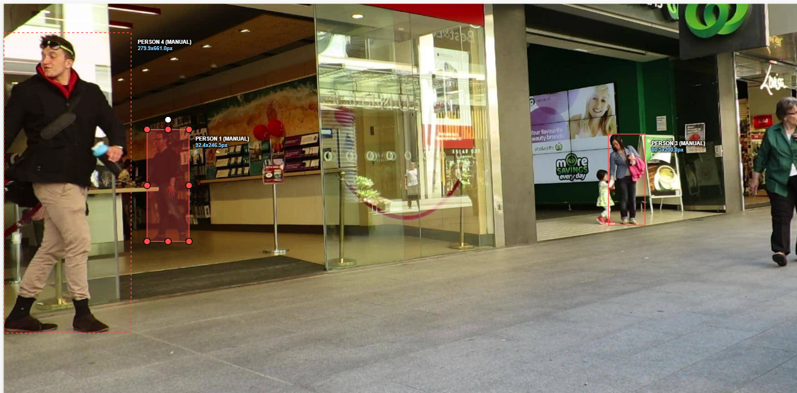
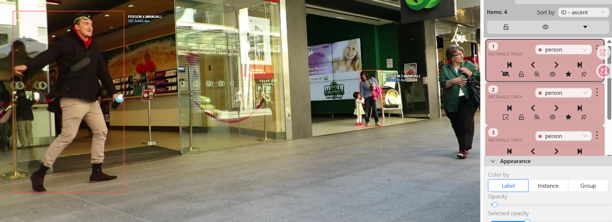
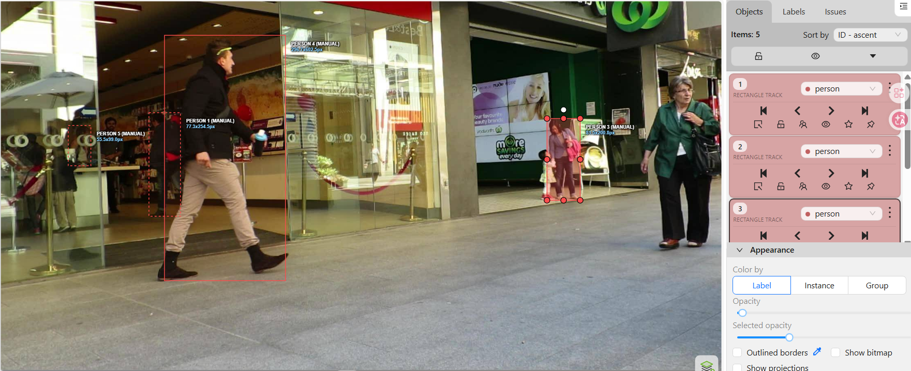

# Báo cáo cá nhân — NguyenXuanLam-2A202604051

Đoạn video: MOT17-09, 150 frame (frame 1–150), nguồn MOTChallenge, giấy phép CC BY-NC-SA 3.0.

## 0. Thông tin học viên

- Họ tên: Nguyễn Xuân Lam
- MSSV: 2A202604051
- Mã đề (A/B/C): C (task `DAY05-MOT17-09-C-2A202604051`)
- Email: xuanlam13072004@gmail.com
- Link repository: https://github.com/xuanlam13072004/K5-L2B-DAY05-NguyenXuanLam-2A202604051-MOTTracking
- Giờ bắt đầu: 16:30
- Giờ kết thúc: 18:30

## 1. Xem trước đoạn video (CP0)

Ghi **trước khi vẽ**, mỗi người một dòng.

| Mã | Frame xuất hiện | Frame cuối thấy được | Rẽ / dừng / đổi tốc độ ở frame | Bị che ở frame | Ghi chú |
|---|---|---|---|---|---|
| P1 | 0 | 149 | Đi chậm sang phải 0–110; từ khoảng 100 lại gần camera (box cao 243 → 354 px); đổi hướng nhẹ sang trái từ khoảng 110 | occluded 0–19, 30–38, 50–53, 100–119; mất hẳn 39–49 | Đàn ông áo len đen, quần jean, đi bên trong cửa hàng Vodafone sau lớp kính. Người dùng cho CP2 |
| P2 | 50 | 149 | Đi sang phải 50–110, đổi hướng nhẹ sang trái từ khoảng 110; lại gần camera dần | occluded 50–109 | Người đứng sau quầy Vodafone, sát khung kính bên trái, bị khung kính và quầy che |
| P3 | 0 | 149 | Đi chéo từ mép phải sang trái và tiến thẳng về camera suốt đoạn, box to nhanh (168 → 937 px), tăng tốc rõ từ khoảng 100 | occluded 0–69 | Ông lớn tuổi đội mũ trắng, áo polo xanh dương, quần nâu; vào từ mép phải |
| P4 | 0 | 109 (outside từ 110) | Đi chậm sang phải 0–30, sau đó đứng yên khoảng 40–109 | occluded 90–109 | Phụ nữ áo xanh xám, quần jean, túi hồng, dắt bé gái trước màn hình Woolworths |
| P5 | 0 | 139 (outside từ 140) | Đi nhanh sang phải và ra xa camera 0–120 (box 669 → 342 px), chậm lại khoảng 120–131 | occluded 0–39, 110–123, 125–139; outside 124 | Thanh niên áo khoác đen, mũ trùm đỏ, quần be, túi chéo; đi vào từ mép trái phía trước |

Bảng nhận diện: CVAT ID 1 = P1, ID 2 = P3, ID 3 = P4, ID 4 = P5, ID 5 = P2. Các số frame ở bảng trên được đối chiếu lại với file `NguyenXuanLam_cvat_video.zip` sau khi gán.

## 2. Keyframe và thời gian (CP1, CP4)

Số keyframe lấy từ kết quả `src/check_submission.py`.

| Mã | Số keyframe | Keyframe ở frame | Số frame có mặt | Keyframe / 100 frame | Thời gian (phút) | Chỗ khó |
|---|---|---|---|---|---|---|
| P1 | 18 | 0, 10, 20, 30, 38, 50, 54, 60, 64, 70, 80, 90, 100, 110, 120, 130, 140, 149 | 139 | 12,9 | 15 | Đoạn bị P5 che |
| P2 | 11 | 50, 60, 70, 80, 90, 100, 110, 120, 130, 140, 149 | 100 | 11,0 | 10 | Bị che khuất sau quầy và khung kính nên khó thấy |
| P3 | 15 | 0, 10, 20, 30, 40, 50, 60, 70, 80, 100, 110, 120, 130, 140, 149 | 150 | 10,0 | 10 | Tiến thẳng về camera, box phóng to rất nhanh (168 → 937 px), đầu và chân dễ lệch ở frame 100–149. Đầu đoạn bị cắt ở mép phải |
| P4 | 6 | 0, 10, 20, 40, 80, 90 | 110 | 5,5 | 10 | Ở xa camera, box nhỏ, dễ lẫn với bé gái đi cạnh. P5 đi ngang che từ frame 110 |
| P5 | 16 | 0, 10, 20, 30, 40, 50, 60, 64, 70, 80, 90, 100, 110, 120, 125, 130 | 139 | 11,5 | 10 | Đi nhanh và ra xa camera (box nhỏ dần), đầu đoạn bị cắt ở mép trái. Cuối đoạn bị P3 che (frame 124, từ 140) |
| **Tổng** | **66** | | **638** | **10,3** | **55** | |

Keyframe / 100 frame của cả bài = tổng keyframe ÷ tổng số frame có mặt × 100 = 66 ÷ 638 × 100 = **10,3**

Bạn đặt keyframe nhiều nhất ở người nào? Vì sao (người đó rẽ, dừng, lại gần camera hay bị che)?

Nhiều nhất ở **P1** (18 keyframe). P1 bị P5 đi ngang che: thêm keyframe ngay trước khi mất hẳn (38), lúc hiện lại (50) và khi thấy rõ trở lại (54), cộng thêm keyframe ở 64 vì box nội suy lệch sau đoạn che. Ít nhất ở **P4** (6 keyframe) vì P4 ở xa camera, đi khá đều, kích thước box gần như không đổi (cao 196–202 px).

## 3. Đoạn bị che (CP2)

Người bị che: `P1` (CVAT ID 1)

| Mốc | Frame |
|---|---:|
| Bắt đầu bị che một phần (bật `occluded`) | 30 |
| Mất hẳn (bật `outside`) | 39 |
| Hiện lại (tắt `outside`) | 50 |
| Thấy rõ trở lại (tắt `occluded`) | 54 |

- Thời gian khuất hẳn: 11 frame (39–49) = 0,37 giây.
- Quyết định: **giữ cùng ID** (track ID 1).
- Lý do (trả lời 3 câu: khuất bao lâu so với 60 frame, ngoại hình có khớp, chỗ hiện lại có đúng hướng và tốc độ):

1. Khuất hẳn 11 frame, nhỏ hơn nhiều so với ngưỡng 60 frame của lớp.
2. Ngoại hình khớp: vẫn là người áo len đen, quần jean, cùng dáng và kích thước box (khoảng 250 px chiều cao).
3. Người hiện lại ở đúng chỗ dự đoán theo hướng đi cũ (đi sang phải bên trong cửa hàng Vodafone), tốc độ không đổi rõ. Người che là P5 (khăn đỏ) đi ngang phía trước camera.

Ảnh chụp màn hình:





Nguồn ảnh: MOT17, MOTChallenge (Milan et al., 2016).

## 4. Tự review ID (CP3)

Lượt 1 theo người (đi ngược từ frame 149 về 0 trên CVAT), lượt 2 theo cảnh (nhảy 10 frame). Ít nhất 3 dòng; không có lỗi thì ghi một dòng "đã kiểm hai lượt, không lỗi".

Loại lỗi dùng đúng một trong 7 mã: `id_switch`, `fragmentation`, `lost`, `merge`, `false_track`, `drift`, `flag`.

| Frame | Mã người | Loại lỗi | Mô tả một câu | Phát hiện ở lượt | Đã sửa? |
|---:|---|---|---|---|---|
| 0–149 | P1–P5 | — | Đã kiểm hai lượt, không lỗi | Lượt 1 + Lượt 2 | — |

Tổng hợp số lỗi theo loại:

| `id_switch` | `fragmentation` | `lost` | `merge` | `false_track` | `drift` | `flag` |
|---:|---:|---:|---:|---:|---:|---:|
| 0 | 0 | 0 | 0 | 0 | 0 | 0 |

Lỗi nào chỉ lượt 2 (theo cảnh) mới thấy, lượt 1 (theo người) không thấy? Vì sao?

Không có. Cả hai lượt đều không phát hiện lỗi.

## 5. File xuất và kết quả tự kiểm (CP4)

| Kiểm tra | Kết quả |
|---|---|
| Tên file MOT 1.1 | `src/exports/NguyenXuanLam_mot.zip` |
| Tên file CVAT for video 1.1 | `src/exports/NguyenXuanLam_cvat_video.zip` |
| Số track ID khác nhau trong `gt/gt.txt` (phải là 5) | 5 |
| Frame `outside` không có dòng trong `gt.txt` (đúng / sai) | Đúng (ID 1 không có dòng ở frame CVAT 39–49) |
| Job đã completed trên CVAT máy cá nhân | Đã chuyển sang completed |

Dán phần tóm tắt in ra từ `src/check_submission.py`:

```text
Số frame in theo CVAT (bắt đầu từ 0). Trong gt.txt, frame_id = frame CVAT + 1.

=== File MOT 1.1: NguyenXuanLam_mot.zip ===
  Số track ID: 5   |   Tổng số box: 638
  [OK]        Đúng 5 track ID.

  Track | Frame có mặt | Số frame | Đoạn vắng (outside)
      1 |   0–149      |      139 | 39–49
      2 |   0–149      |      150 | -
      3 |   0–109      |      110 | -
      4 |   0–139      |      139 | 124
      5 |  50–149      |      100 | -


=== File CVAT for video 1.1: NguyenXuanLam_cvat_video.zip ===

  Track | Nhãn   | Frame thấy | Keyframe | KF/100 frame | Frame occluded | Lần bật outside
      0 | person |        139 |       18 |         12.9 |             53 |               1
              Track 0: keyframe ở frame [0, 10, 20, 30, 38, 50, 54, 60, 64, 70, 80, 90, 100, 110, 120, 130, 140, 149]
      1 | person |        150 |       15 |         10.0 |             70 |               0
              Track 1: keyframe ở frame [0, 10, 20, 30, 40, 50, 60, 70, 80, 100, 110, 120, 130, 140, 149]
      2 | person |        110 |        6 |          5.5 |             20 |               1
              Track 2: keyframe ở frame [0, 10, 20, 40, 80, 90]
      3 | person |        139 |       16 |         11.5 |             69 |               2
              Track 3: keyframe ở frame [0, 10, 20, 30, 40, 50, 60, 64, 70, 80, 90, 100, 110, 120, 125, 130]
      4 | person |        100 |       11 |         11.0 |             60 |               0
              Track 4: keyframe ở frame [50, 60, 70, 80, 90, 100, 110, 120, 130, 140, 149]

  Tổng: 66 keyframe / 638 frame có mặt = 10.3 keyframe / 100 frame
  [OK]        Đọc được 5 track từ annotations.xml.

=== Tóm tắt ===
  Lỗi: 0   |   Cảnh báo: 0
  Đạt. Dán phần tóm tắt này vào báo cáo mục 5.
```

## 6. Ba câu kết

1. Nếu được gán lại, bạn sẽ đặt keyframe khác ở đâu? Vì sao?

   - Tăng keyframe ở P3 (frame 100–149): P3 tiến rất sát camera, kích thước box phóng to nhanh, nội suy tuyến tính dễ bị trôi ở đỉnh đầu và bàn chân nên cần đặt dày hơn (khoảng 5–7 frame một keyframe).
   - Giảm keyframe ở P4 (frame 40–109): P4 đứng yên một chỗ, kích thước box không đổi nên chỉ cần 2 keyframe ở frame 40 và 109 là đủ chính xác.

2. Có chỗ nào bạn không chắc "cùng ID hay ID mới"? Bạn đã quyết định và ghi chú thế nào?

   - Vị trí: P1 bị P5 che khuất hoàn toàn ở frame 39–49 (bên trong lớp kính Vodafone).
   - Quyết định và ghi chú: giữ cùng track ID 1 vì chỉ khuất 11 frame (< 60 frame), ngoại hình vẫn là áo len đen, quần jean, và vị trí xuất hiện lại ở frame 50 tiếp nối đúng hướng đi sang phải. Tôi bật `outside` ở frame 39–49 và ghi chú trong mục 1 và mục 3 của báo cáo.

3. Một lỗi ID trong job của bạn (nếu không còn sót, chọn lỗi đã sửa) có thể làm xe tự lái dự đoán sai chuyển động của người đó như thế nào? Lỗi đó ảnh hưởng MOTA hay IDF1 nhiều hơn?

   - Dự đoán sai chuyển động: nếu bị `id_switch` (ví dụ ID của P1 nhảy sang P5 lúc P5 đi ngang qua che P1), tâm box dịch chuyển đột ngột trong 1/30 giây, bộ lọc vận tốc tính ra tốc độ người đi bộ vọt lên hàng trăm km/h. Xe tự lái sẽ đoán sai hướng di chuyển, có thể phanh gấp không cần thiết (phantom braking) hoặc đánh lái nguy hiểm.
   - Ảnh hưởng IDF1 nhiều hơn: MOTA tính lỗi theo từng frame nên một lần đổi ID chỉ cộng 1 vào IDSW (với khoảng 600 box GT, MOTA giảm chưa tới 0,2%). Ngược lại, IDF1 ghép cả track với cả người thật, nên toàn bộ phần track sau khi đổi ID bị tính sai (đổi ở giữa đoạn thì mất khoảng một nửa số frame ghép đúng), kéo IDF1 xuống rất nặng.

## Bonus (nếu làm)

Không làm.

## 7. Tài liệu tham khảo và công cụ AI đã dùng

- Tài liệu: `docs/GUIDELINE.md`, `docs/CVAT_CHEATSHEET.md`, `docs/MOT_FORMAT.md`, tài liệu CVAT.
- Dữ liệu: MOT17, MOTChallenge (Milan et al., 2016), giấy phép CC BY-NC-SA 3.0.
- Công cụ AI: Claude (Anthropic). Dùng để đọc và tóm tắt yêu cầu của repo, giải thích cách dùng cờ `occluded` / `outside` trong CVAT, chạy và giải thích kết quả `src/check_submission.py`, điền số liệu lấy từ file xuất vào mục 0, 1, 2, 3, 5. Không dùng AI để sinh box hay track ID, không dùng AI viết mục 4 và mục 6.
